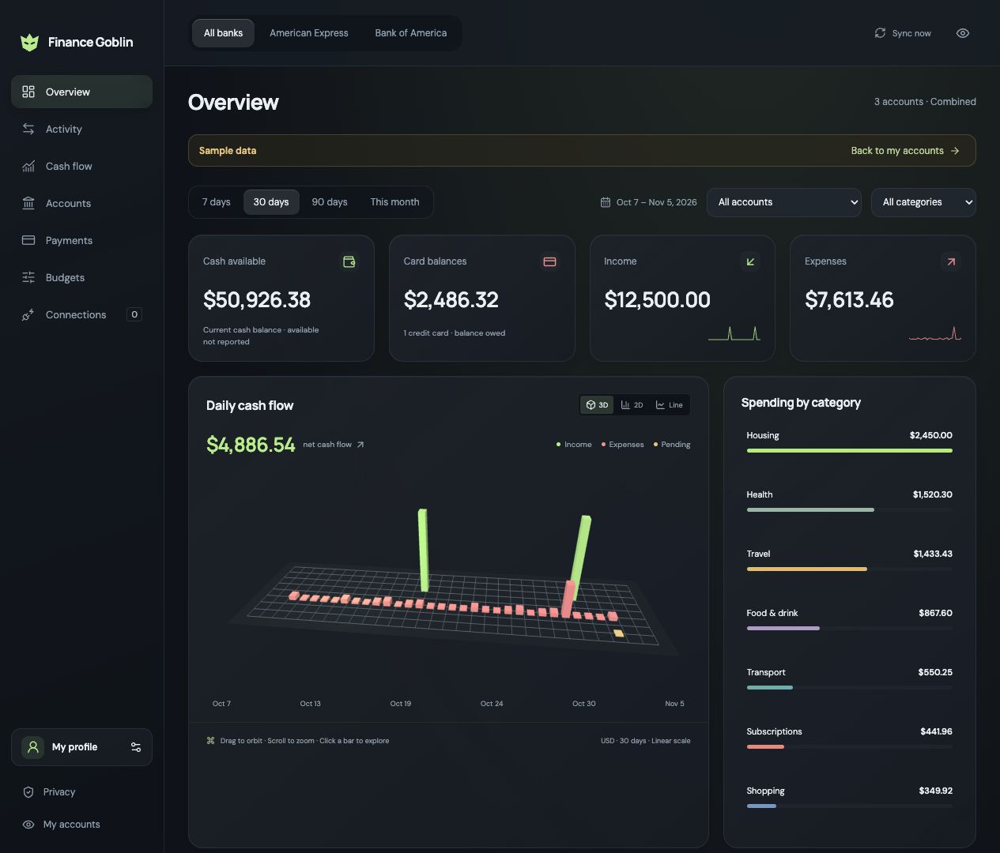
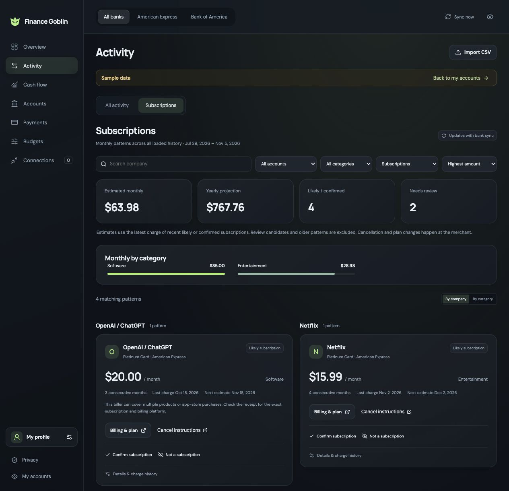

# Finance Goblin

The desktop now has a shared entrance for **Life** and **Finance Goblin**. Life adds Today, Calendar, Projects, School, People (Connect), Inbox, Memory, and Settings. Both workspaces have a scoped Hermes assistant with document/image intake. See [Life setup, sources, privacy and assistant boundaries](docs/LIFE.md).

A local personal-finance desktop app with interactive 3D cash flow, category analytics, available cash, credit-card balances, payment plans, and a customizable glass interface.

**Development preview · Apple Silicon macOS · MIT**

Your data lives on your computer. Start with generated sample data, then connect your own Plaid account, an existing Actual Budget server, or import a CSV. No shared API keys, hosted service, analytics, or cloud database are included.



_Dashboard preview using generated sample data. No real bank information is shown._

## Start locally

Requirements: Apple Silicon Mac, Node.js 24, npm, and Apple's Xcode command-line tools (`xcode-select --install`). The current desktop builder has been exercised on macOS 15.8.1. Intel Mac, Windows and Linux installers are not supported yet. Source tests and the browser build also run on Linux.

```sh
git clone https://github.com/henrymadsen7/finance-goblin.git
cd finance-goblin
npm ci
npm run desktop:install
```

Open **Finance Goblin** in `~/Applications`. The installed app bundles Node and Electron, so routine use needs no terminal. No notarized public download is available yet; build from source. Do not bypass operating-system security warnings.

To update, quit with **Command-Q**, then run `npm ci` and `npm run desktop:install -- --replace`. The prior bundle is preserved in `~/Library/Caches/Finance Goblin/Build`. Your vault is outside the bundle and survives updates. Closing the window leaves sync running; Command-Q quits. The app does not start at login.

For development, quit the desktop app and run `npm run dev`. Open the private, single-use launch link printed in the terminal within five minutes; ordinary localhost requests are rejected. Do not share the link or logs containing it. Browser development uses a separate `.local` vault and supports Plaid Sandbox only. Use sample data for development. For desktop development, run `npm run build` and `npm run desktop`.

## Connect your information

1. Explore **Sample data** first; no account or credentials are needed.
2. Switch to **My accounts**, then open **Connections**. A fresh real workspace is empty.
3. Choose a source: configure your own Plaid credentials in the app, connect an existing Actual server, or preview and confirm a CSV import.

Enter credentials only in the app or the provider's official authorization page. Each user needs their own Plaid account, eligible products and institution consent. Sandbox uses fake data; Production access, billing and bank availability are controlled by Plaid. Bank of America and Amex authorization have been exercised; successful access for other users or banks is not guaranteed. Do not connect the same account through multiple sources, as cross-provider duplicates are not inferred.

Desktop Plaid authorization opens your normal browser and returns to the app. It uses popup OAuth without a custom localhost redirect or certificate. Actual uses its official API against your existing server. This app does not install Actual or edit its ledger.

See [connections, CSV format, synchronization, and privacy](docs/SETUP.md).

## Use the dashboard

- **Overview:** available deposit cash and card debt are separate from income and posted purchase expenses. Available credit is never cash. Unknown balances stay unknown.
- **Bank and account filters:** view one bank, one account, or combined KPIs. Date and exact-category filters update charts, activity and exports together. Balances remain account-level values.
- **Charts:** switch between 3D, 2D columns and a line. Move across a day to inspect income, spending less refunds, pending and net change; select it to explore transactions. 2D columns support keyboard inspection. The 3D view supports orbit and zoom with a 2D fallback.
- **Subscriptions:** open **Activity → Subscriptions** to find monthly charges across multiple months, group by company/category, review evidence and estimated costs, and open billing or cancellation instructions. Confirm or hide suggestions and customize categories or billing links locally. [Detection and limitations](docs/SUBSCRIPTIONS.md).
- **Activity and Budgets:** inspect category spending and monthly limits. Budgets are explicitly across all banks. Pending and transfers do not enter posted spending; refunds reduce expenses. Aggregated KPIs use USD only.
- **Payments:** set your own monthly due day and earlier pay-by target, open the issuer, or export recurring calendar reminders. Nothing can send a payment or enroll AutoPay. Current balance is not the statement amount due. Mark AutoPay confirmed only after checking at your bank.
- **Settings:** click your profile name or press **Command-comma**. Preview custom colors, category palettes, corner radius, profile/time zone, and widget visibility/order. Save persists locally; closing cancels the preview.

The app checks its local snapshot every minute and retrieves available bank updates every 30 minutes while running. **Sync** checks sooner; it does not guarantee newly available bank data. Calendar exports must be imported into your calendar; changing a plan does not update an already imported reminder. No assistant reminders are bundled for other users.

<details>
<summary>Preview subscription tracking with sample data</summary>



</details>

## Privacy and limits

The desktop renderer is sandboxed; a private, in-memory session gates its loopback API. Each temporary bank browser session is bound to one connection, cannot read the dashboard, and is revoked on completion. Data and credentials use AES-256-GCM; macOS Keychain protects the vault key. Bank access tokens stay in the local service, not the renderer. The provider transport permits only the implemented data, linking and revocation operations; no payments or transfers.

Each installation is a separate single-user workspace with its own provider credentials. This is not a hosted multi-user service. Keychain protection reduces file-theft risk; it cannot guarantee protection from malware, a compromised OS/provider, a malicious build, or someone using your unlocked app. No independent security audit or notarized release has been completed. Hide amounts is visual masking only. See [security protections, upgrade and recovery limits](docs/SECURITY_MODEL.md) before connecting real accounts.

Bank data can lag, categories can be incomplete, and this preview does not offer transaction recategorization or account reconciliation. No financial advice, payments, transfers or trading are implemented. A real Actual ledger has not yet been verified. See [security](SECURITY.md) and [architecture](docs/ARCHITECTURE.md).

## Contribute and validate

```sh
npm run check
npm test
npm run build
npm run check:source
npm audit
```

See [contributing](CONTRIBUTING.md), [community conduct](CODE_OF_CONDUCT.md), and [release preparation](docs/RELEASING.md). Tests use temporary stores, synthetic transactions and fake provider calls; they require no API keys. CI runs type checks, tests, source-pattern checks, a browser production build and a dependency audit. It does not publish binaries.

## License and provenance

This standalone application is [MIT licensed](LICENSE); dependencies retain their own licenses. [Third-party notices](THIRD_PARTY_NOTICES.md) cover bundled React, Three.js, icons, fonts and [Liquid Glass React](https://github.com/rdev/liquid-glass-react). Server package notices ship in the installed dependency tree.

Finance Goblin was developed as a new Electron/React application inside a larger Surf-Finance workspace. This standalone repository contains the new application only. The original private Swift Surf application and its Git history are excluded and are not relicensed by this project's MIT license. Actual Budget is integrated through a dependency, not copied into this source tree. Names of banks and providers identify integrations and do not imply affiliation.

The assistants now include chat projects, independent conversations, recoverable archives, and a shared **Memory** navigation page. Search retained source excerpts and saved facts, filter by workspace/project/date, or explore their associations in 2D and 3D. See [the memory architecture and open-source review](docs/MEMORY.md) for storage, recall boundaries, dependencies and validation.

To customize the assistants, open **Ask → Assistant settings → Chat appearance**. Glass, White, Black, and custom background/accent colors preview immediately; **Save chat appearance** keeps the choice for both workspaces. Text and panel colors adjust automatically.

Move the desktop window by dragging empty space along its top edge, Life header, or assistant header.
