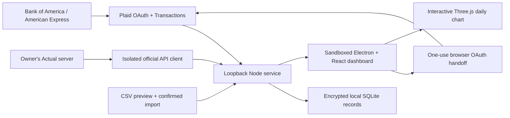

# Finance Goblin architecture

Finance Goblin is a distinct Electron desktop application with a bundled Node service and its own data store. It uses the official Actual API and Plaid HTTP API; neither upstream application is vendored.

## Boundaries

The browser never receives provider secrets. Plaid public tokens are exchanged server-side; access tokens are encrypted locally. Actual credentials enter only the local service and its isolated child process. The Actual working copy is temporary, mode 0700, and deleted after normal completion; the dashboard's persisted projection is encrypted.

The desktop app gates the loopback service with a random per-launch HttpOnly cookie in Electron’s isolated session. A one-use 60-second handoff ticket creates a separate 30-minute browser session limited to bank authorization; financial state and configuration routes remain app-only. Desktop bank linking uses Plaid’s supported browser popup flow without a custom redirect URI. The optional standalone browser version retains redirect resumption. The scoped browser authorization cookie uses SameSite=Lax. The renderer is sandboxed, context-isolated and has no Node integration.

It provides no biometric or cross-user authentication layer. Host validation and CSRF protect against ordinary hostile websites, not another process running as the owner. No server is exposed to other computers.

## Consistency

A Plaid Item cursor advances only with its associated data changes. Pagination mutations restart from the original cursor. Source failures retain the last complete snapshot and publish the failure. Actual projection replacement commits atomically after a full read. SQLite transactions roll back on failure. Integer cents avoid binary floating-point accumulation in financial totals.

Sample data is generated independently and never inserted into the real vault. Data sources use separate record IDs; cross-source identities are not guessed. USD aggregation is explicit. The app does not automatically infer missing balances, match transfer counter-legs, reconcile accounts, or repair bank classifications.

## Operational contract

The service runs inside the desktop application and stops on Command-Q. Closing the window on macOS leaves it running. The vault is stored outside the app bundle in `~/Library/Application Support/Finance Goblin/vault`; rebuilding the app preserves it. Local snapshot checks occur each minute; provider retrieval every 30 minutes and on demand. Bank freshness is distinct from retrieval freshness. There are no webhooks requiring a public inbound endpoint, no paid transaction-refresh calls, and no credentials in the Git repository.

See [README](../README.md) and [connection guide](SETUP.md) for setup and validation.

## Dashboard scope and rendering

`src/finance.ts` selects accounts by institution and account ID before calculating either balances or transaction totals. Combined, bank, and account views use the same scope. Only USD amounts enter aggregate KPIs; credit and loan balances reduce net balance, pending records stay separate, transfers do not count as income/spending, and refunds reduce expenses. Budgets are explicitly global monthly limits.

The current visual layer is isolated in `src/theme.css`, with base component layouts in `src/styles.css`. The MIT-licensed Liquid Glass React library supplies decorative refraction under semantic buttons; no financial data is supplied to remote rendering services. Opaque fallbacks honor reduced-transparency and increased-contrast preferences. The Three.js scene renders after data changes, control interactions and resize, with no perpetual animation loop.

The idempotent local Plaid category migration corrects the former broad Entertainment-to-Subscriptions label. It preserves all amounts, account IDs, transaction IDs and dates, other data sources, and user budget limits. Future Plaid normalization uses Entertainment directly.

## Preferences, payment plans, and analytics

The validated `/api/preferences` route persists profile name, IANA time zone, color palette, ordered widget IDs, and card payment plans as encrypted records. The browser bank-handoff session cannot access this route. Payment plans must reference a connected credit account; plans cannot submit payments or enroll AutoPay. The default profile and widget configuration are portable; owner-specific data remains in the vault.

`src/finance.ts` separates current net position, available deposit cash, and credit debt, and builds exact category summaries from posted expenses/refunds with separate pending totals. Account-level balances do not change when a transaction category is selected. `src/payment-dates.ts` handles local-date boundaries, month-end clamps, and portable recurring calendar exports. 3D, SVG line and 2D columns share the same daily totals and tooltip, respect hidden-amount mode, and render without a continuous animation loop.
